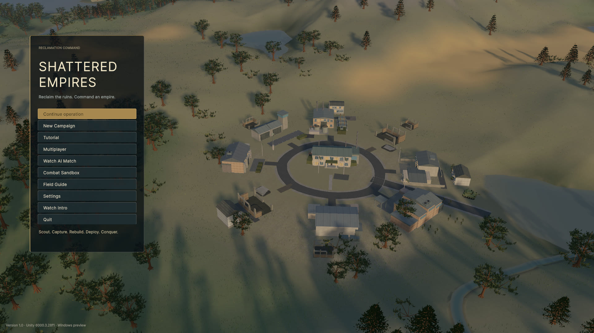
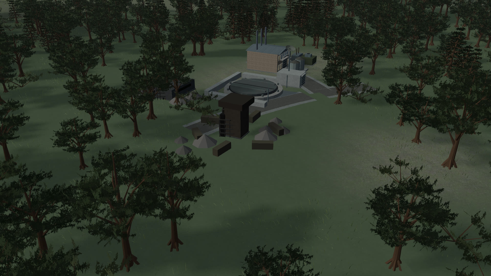

# Rendering and contextual UX working report

- **Type:** Working implementation report
- **Updated:** 2026-11-13
- **Scope:** Local rendering/UX development begun 2026-11-12; no new release publication
- **Classification:** Functional prototype / Visually incomplete
- **Current follow-ups:** [Status](UNITY_PROGRESS.md), [queue](DEVELOPMENT_QUEUE.md)

## Source and verification boundary

This report covers an intermediate local development build and later, unverified working-tree
amendments. The documentation-only review commit includes this report and the selected images,
not the implementation or new runtime assets.

Earlier local Unity `6000.3.28f1` Windows builds succeeded with zero errors, approximately
143 MB of uncompressed player content, and a final recorded build duration of about 15 seconds.
Those compile results precede the latest road graph, bridge, map, interface and shortest-grass
changes. They are not evidence that the latest working tree compiles.

Manual checks were actual visual scene reviews, after the main initial implementation batch.
No new manual gameplay, balance, load or soak campaign was run. No current FPS/p99 result,
multiplayer acceptance, final art approval or production acceptance is claimed.

## Initial local implementation

- Foliage is explicitly diffuse/nonemissive. Safe normal math, invalid-HDR rejection, bounded
  bloom, camera NaN suppression and transient-light cleanup address the giant glare.
- Scale conventions connect soldier height, vehicles, storeys and doors. New city footprints are
  dry and graded into level authoritative compounds with blended approaches.
- Groundcover is reduced; ground, fabric and metal source maps add restrained surface variation.
  New asset/source records remain with the separate implementation work.
- Vehicles slow for turns/final approaches, avoid sideways stepping and follow authoritative hull
  orientation without the previous second slow client rotation filter.
- Trench orders, line-based cover and soldier grounding use the actual trench; soil is darkened.
  Bounded local combat maneuvers preserve orders while improving cover/firing positions.
- AI opening changes delay full base offensives while retaining scouting/expansion.
- A purchased city-perimeter prototype creates four sandbag positions and two machine-gun turrets
  for 240 Materials and 60 Energy over 25 seconds, with proportional rebuilding.
- Q/E rotates defensive placement in 15-degree steps; previews, legality and saved yaw agree.
  Invalid placement retains the tool and explains the reason.
- Runtime tooltip, contextual construction and borderless-startup work is present. The earlier
  tooltip capture did not verify a visible real hover; that remains open.
- Directional firing origins and shorter conventional flashes reduce misplaced visual noise.

These are prototype/source descriptions. They do not grant feature or quality acceptance.

## Visual review correction

Earlier review used URP SingleCameraRequest, which could omit camera-stack volume updates and miss
the user's normal-game glare. Capture was changed to the full StandardRequest camera-stack path.
Black/unavailable hidden-window backbuffer attempts were rejected as evidence. Final color
readback uses an sRGB ARGB32 target.

The valid full-camera captures showed no giant stray white foliage orbs in the reviewed menu,
silo and gameplay scenes. This narrows the observed local result; it does not prove every GPU,
quality preset or published binary is fixed.

## Selected actual Unity captures

These are intermediate-build images, before the newest road, bridge, map, contextual-UI and
very-short-grass amendments. Old interface elements visible here are not the target design.

[Capture provenance and limitations](reviews/2026-11-13-doc-review/README.md) accompany these frames.

## Later changes awaiting review

Source work now joins compound streets/approaches through a shared road graph, adds common bridge
support levels and bank ramps, reduces unused outer land around objective/route geography, removes
Army/Objectives/global-upgrade navigation, moves Armory research onto the selected facility and
removes the bottom city-slot shortcut grid.

The latest grass request reduces blades to very short groundcover and adjusts their rooting.
These follow-ups require a new successful build and replacement visual captures.

Independent soldier movement in formation turns and stable mountain-camera focus/picking are
still open implementation requests. They are not claimed as fixes in this report.

## Remaining defects and next work

Complete the pending source batch, then review road junctions, bridges, world construction and
very short grass beside units. Implement independent soldier positioning and the camera correction.
Check real runtime tooltips and disabled controls.

Procedural architecture, fir silhouettes, shoreline blending, infantry motion, city-turret tracking
and authored animation still need work. Existing saved hillside cities are not silently regenerated.
After the owner's review scope changes, measure sustained combat, frame pacing, long-session
stability and obtain human art/audio/balance approval through [verification](VERIFICATION.md).
